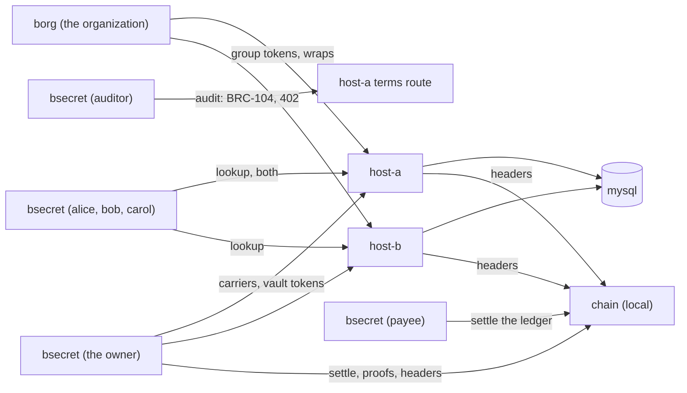

# Quickstart

Two ways in. **On mainnet or testnet** you fund the owner's home with a
small payment from your own wallet and use overlay hosts that carry the
borg and bsecret modules. **In the local development sandbox** a private
regtest chain stands in for the network, so no coin is needed; it is for
trying bsecret and for development, not for real use.

## On mainnet or testnet

You need:

- A borg organization with a group, and `borg org signer` run once in its
  borg home ([borg's quickstart](https://github.com/lightwebinc/borg/blob/main/QUICKSTART.md)).
- BSV in a wallet you control (testnet coin on testnet). About 10,000 sat
  covers a vault and about ninety versions; a version costs about 107 sat
  ([limits.md](docs/limits.md)). The borg home is funded separately.
- Overlay hosts that carry the crypt (and the group's hall): borg's host
  image with the bsecret module added, or the module on any reference
  overlay host ([host.md](docs/host.md)).

No node is needed. bsecret reads headers, transactions, proofs and spends
from WhatsOnChain and broadcasts through GorillaPool's public arcade by
default, checking every proof against the headers
([configuration.md](docs/configuration.md#no-node-needed)). A node of your
own (`chain = asset:<URL>`), your own header service (`header_url =
bhs:<URL>`) and your own broadcaster (`settle = arcade:<URL>`) are the
better options where you have them.

```console
$ mkdir -p ~/.bsecret && cat > ~/.bsecret/config <<'CONF'
network    = main
mode       = unicast
hosts      = https://host-a.example.com,https://host-b.example.com
hall       = example_qzxkvbmwtr
CONF
$ bsecret init -borg ~/.borg
created /home/you/.bsecret around the identity in /home/you/.borg/identity.json
identity     02c6...
fund address 1Ab... (main)
```

The fund address is bsecret's own, not the borg home's. Send about 20,000
sat from your own wallet to it, then import the payment: by its txid once
it has one confirmation, or at once from the BEEF your wallet handed over:

```console
$ bsecret fund -txid <txid>          # or: bsecret fund -beef payment.beef
$ bsecret crypt new example          # give the printed BSECRET_CRYPTS line to your hosts
$ echo 'crypt = example_<suffix>' >> ~/.bsecret/config
$ bsecret doctor                     # every endpoint answers?
$ bsecret vault create engineering -name ops
$ bsecret put db/password < new-password.txt
```

Each member makes a home around its own borg home (`bsecret init -borg
~/.borg`, no coin needed) and, with `crypt`, `org`, `vault` and `hosts` in
its config, reads:

```console
$ bsecret get db/password
```

For testnet use `network = test`; the headers, chain view and broadcaster
follow it, and the fund address then starts with `m` or `n`. Every command after that is the same. The whole walk, with a
revoke, an audit and a second home, is [docs/examples.md](docs/examples.md).

## Local development sandbox (no coin needed, a private regtest chain)

In about ten minutes, on one machine: run two overlay hosts that carry a
borg hall and a bsecret crypt, create an organization with three members
and a group (borg), create a vault on the group, put three secrets that
every member reads, remove one member and watch the vault fall behind,
acknowledge the new epoch and re-key so that the removed member reads none
of the new versions, retire a secret, pay a host's 402 for the audit and
read the exposure window from block headers, and check that the two hosts
hold the same. A local regtest chain stands in for the network and mines
coinbase to each home that needs coin (coinbase: only on a regtest chain
you run, for development and tests); nothing it mines is money.

You need [Docker](https://docs.docker.com/get-docker/) with Compose, and
this repository. Build the images first (`make docker-build` here and
`make docker-build-host BORG_HOST_IMAGE=<borg's host image>`, and borg's
command image from the borg repository), or set `BSECRET_IMAGE`,
`BSECRET_HOST_IMAGE`, `DEVCHAIN_IMAGE` and `BORG_IMAGE` to published ones.



### 1. Start the local chain

```console
$ cd deploy/quickstart
$ docker compose up -d chain
$ borg() { who=$1; shift; docker compose run --rm -T -e BORG_HOME=/home/nonroot/.borg/$who borg "$@"; }
$ bs()   { who=$1; shift; docker compose run --rm -T -e BSECRET_HOME=/home/nonroot/.bsecret/$who bsecret "$@"; }
```

`chain` is a stand-in for the network: it serves a node's API, mines every
transaction it is sent at once, and is the header source the hosts and both
commands check proofs against. Nothing it mines is money. `borg org ...`
runs the borg command with the organization's borg home, and `bs org ...`
the bsecret command with the organization's bsecret home; each identity has
one of each.

The images are `ghcr.io/lightwebinc/bsecret`, `bsecret-host` and
`bsecret-devchain`, and borg's command image `ghcr.io/lightwebinc/borg`.

### 2. An organization and three members, and a home of each for bsecret

```console
$ borg org init | tee org.txt && borg org fund
$ for m in alice bob carol; do borg $m init | tee $m.txt; done
$ key() { sed -n 's/^identity *//p' $1; }
$ ORG=$(key org.txt) ALICE=$(key alice.txt) BOB=$(key bob.txt) CAROL=$(key carol.txt)
$ for m in org alice bob carol; do bs $m init -borg /home/nonroot/.borg/$m; done
created /home/nonroot/.bsecret/org around the identity in /home/nonroot/.borg/org/identity.json
identity     02c6…9a1e
fund address n1Qx…7Wd (regtest)
...
$ bs org fund
$ bs payee init
$ bs auditor init && bs auditor fund
```

The organization and its members are borg's: each is an identity key in a
borg home. A vault's owner is the organization, and its readers are the
members of one of the organization's groups, so each bsecret home is made
**around the identity of a borg home** (`init -borg`): the same key, and
nothing else shared. The two homes keep separate coin: `bs org fund` (no
`-txid`) mines coinbase to bsecret's own fund address on the sandbox chain
(coinbase: only on a regtest chain you run, for development and tests; on
mainnet or testnet you import a payment with `fund -txid` or `fund -beef`
instead). The
members need no coin. The payee is host-a's, and the auditor is anyone at all: it is funded only to pay for
the priced audit later.

### 3. A hall, a crypt, the payee key

```console
$ borg org hall new example | tee hall.txt
hall  example_qzxkvbmwtr
topic tm_borg_example_qzxkvbmwtr
host  BORG_HALLS=example_qzxkvbmwtr
$ bs org crypt new example | tee crypt.txt
crypt example_hmqzvtkwrx
topic tm_bsecret_example_hmqzvtkwrx
host  BSECRET_CRYPTS=example_hmqzvtkwrx
$ sed -n 's/^host *//p' hall.txt crypt.txt > .env
$ echo "BSECRET_ORG=$ORG" >> .env
$ bs payee payee key -out - >> .env
```

A hall is where borg's groups live and a crypt is where vaults live; each
name gets a random suffix, so nobody else's shares its topic. `.env` hands
both to the hosts and to the commands, the organization's key to the
readers, and the payee key to host-a.

### 4. Start two hosts

```console
$ docker compose up -d
$ bs org doctor
...
mode        unicast: every object to each of 2 host(s); a carrier published once 2 take it (quorum all), a token or sweep once all do
host        http://host-a:8080 answering
host        http://host-b:8080 answering
paid host   http://host-a:8090 serves terms (4 priced class(es))
```

Each host loads the borg module and the bsecret module. The first start
takes a few seconds while MySQL initializes; run `doctor` again until both
hosts answer.

### 5. The organization, a group, and the signer key

```console
$ borg org org create 'Example Organization' -member $ALICE -member $BOB -member $CAROL
$ borg org group create engineering -member $ALICE -member $BOB -member $CAROL
group   5a0c4d…9d12
name    engineering
seq     0 3f9a…c410 epoch 0, 3 member(s), wrapped to each
$ borg org org signer
signer  03d1…77c2
```

borg issued each member a grant, created the group with a random epoch key,
and wrapped the key to each member. `org signer` makes the organization's
own signer key a member of every group, so that the organization's tooling
holds each epoch's key the way a member does: bsecret opens it from that
wrap, and keeps no epoch key itself.

### 6. A vault on the group, and three secrets

```console
$ bs org vault create engineering -name ops | tee vault.txt
vault   7b1e…04aa
name    ops
crypt   example_hmqzvtkwrx
group   5a0c4d…9d12 in hall example_qzxkvbmwtr
epoch   0
anchor  version
labels  confidential,internal,public,restricted
token   seq 0 9c41…e2d0 mined at height 912
$ VAULT=$(sed -n 's/^vault *//p' vault.txt)
$ printf 'hunter2' | bs org put db/password
secret  db/password version 1 label confidential epoch 0: carrier 41f0…b7a3 (created)
token   seq 1 0e6d…58c1 mined at height 914: 1 secret(s), 0 stale, epoch 0
$ printf 'tok-1' | bs org put api/token
$ printf 'KEY' | bs org put tls/key
```

The vault is a chain of mined tokens bound to the group for good. Each
`put` drew a content key of its own, sealed the value, wrapped the key to
the owner's wallet and under the group's epoch 0 key, published the
carrier to both hosts, and listed the version in the vault's next token. A
value is read from standard input, never from an argument.

### 7. Every member reads

```console
$ bs alice get db/password
hunter2
vault   7b1e…04aa ops seq 3: settled at epoch 0
latest  seq 3 is the latest: its output is unspent per the node
secret  db/password version 1 label confidential epoch 0, read as a member: anchored, current
$ bs alice list
api/token  version 1 label confidential epoch 0
db/password  version 1 label confidential epoch 0
tls/key  version 1 label confidential epoch 0
host http://host-a:8080: 3 secret(s), the set's root reproduced
host http://host-b:8080: 3 secret(s), the set's root reproduced
```

`get` walked the vault's chain from its first token at both hosts, checked
every token against the headers, folded it, checked that the set holds
this version, checked the ciphertext's hash, opened alice's wrap of epoch 0
from borg, opened the content key's wrap under it, checked the key against
its commitment, and only then decrypted. The value goes to standard output
(it is a pipe here; on a terminal it is written only with `-show`), and
everything else to standard error. Bob and carol read the same.

### 8. Revoke bob

```console
$ printf 'correct horse' | bs org rotate -check -set db/password=- -same-all
ready   3 secret(s) owe a re-keying or a retirement (were the group to begin a new epoch now), and each has a choice: a revoke can be finished in 1 token(s)
$ borg org org remove $BOB -group engineering
group   5a0c4d…9d12 seq 2 af36…6acd epoch 1 (a new epoch: a fresh key, wrapped to every member)
$ bs alice get db/password > /dev/null
vault   7b1e…04aa ops seq 3: BEHIND: it acknowledges epoch 0 and the group is at epoch 1
secret  db/password version 1 label confidential epoch 0, read as a member: anchored, EXPOSED: keyed under epoch 0 and the group is at epoch 1, so a key the group has since removed or rotated away from opens it
$ printf 'correct horse' | bs org rotate -set db/password=- -same-all
epoch   1 acknowledged: the group began it at height 917 (a removal)
rekeyed api/token: the same value under epoch 1
rekeyed db/password: a new value under epoch 1
rekeyed tls/key: the same value under epoch 1
token   seq 4 5d77…90be mined at height 918: 3 secret(s), 0 stale, epoch 1
swept   3 version(s) keyed under epochs that have ended, or never listed: retracted at every honest host
vault   7b1e…04aa settled at epoch 1
$ bs alice get db/password
correct horse
$ bs bob get db/password
bsecret: undecryptable: this key holds no key of epoch 1, the epoch the record names: ...
$ echo $?
1
```

A revoke has three parts. The removal is borg's: it begins epoch 1, whose
key bob never receives. Until the vault acknowledges it, every reader
reports the vault **behind** and its values **exposed**, and the owner's
tooling builds nothing else. `rotate` then acknowledges the epoch and
re-keys: every secret needs a new value (`-set`), an explicit same-value
re-keying (`-same`, or `-same-all`) or a retirement (`-retire`), because a
re-keyed credential that keeps its old value is still known to bob.
`rotate -check`, before the removal, says whether the choices cover the
vault. From the acknowledgement on, every host refuses anything else on
the vault's chain until nothing is stale. The old versions are swept, so
the hosts stop answering what bob can still open; a copy he kept stays his.

### 9. Retire a secret

```console
$ bs org retire api/token
retired api/token
token   seq 5 77c0…1e3f mined at height 920: 2 secret(s), 0 stale, epoch 1
swept   1 version(s): retracted at every honest host
```

### 10. The audit, and the payee

```console
$ bs auditor terms
service ls_bsecret, terms 1
history        5 sat a question
history-after  5 sat a question
audit          20 sat a question
audit-after    20 sat a question
$ bs auditor audit
paid 20 sat to 0268…a450 in 9ade…7f2e for audit, broadcast by the host for its payee to settle
vault   7b1e…04aa ops
owner   02c6…9a1e
...
token   seq 4 5d77…90be height 918 epoch 1 +0 ~3 -0: 3 secret(s), 0 stale: consistent
token   seq 5 77c0…1e3f height 920 epoch 1 +0 ~0 -1: 2 secret(s), 0 stale: consistent
epoch   1 began at height 917 (a member removed): acknowledged at height 918, settled at height 918
window  epoch 1: 1 block(s) from the block that began it to the token after which nothing was listed under an earlier epoch
secret  41c2…9f0e re-keyed at seq 4, height 918: listed under epoch 0 until then, 1 block(s) exposed
...
ends    seq 5 77c0…1e3f height 920: the audit covers nothing after it; the trail's last token is unspent per the node: it is the vault's latest
audit   OK: 6 token(s) mined, the owner's, linked from the first, lawful, consistent and keyed to the group
$ bs nobody -org $ORG -vault $VAULT audit -free
$ bs payee payee settle /var/lib/bsecret-a/payments.jsonl
1 payment(s) settled, 20 sat; 0 settled before; 0 not settled; 0 refused (0 before); pool 1 output(s), 20 sat
```

The auditor holds no key and reads no secret. It asked host-a's terms route
for the vault's whole chain over BRC-104; host-a answered 402 with its
price, the command paid it (BRC-105) and asked again. It then checked every
token against the headers, and against the group's chain, and derived the
**exposure window**: how many blocks passed between the removal and the
token after which nothing was listed under an epoch bob held. `audit -free`
reads the same tokens one at a time through the free class, with no home
and no coin (`nobody` is a home that does not exist). `payee settle` took
the payment into the payee's wallet: checked, broadcast, mined, pooled.

### 11. Do the hosts agree?

```console
$ bs alice fill
filled  0 object(s) at 0 host(s)
$ bs alice due
vault   7b1e…04aa ops seq 5: settled at epoch 1
nothing is due
```

`fill` compared what the two hosts answer (the vault's chain, its set's
carriers, the sweeps) and found nothing to copy. Had host-b been down while
the owner published, every reading command would say `DISAGREES`, and
`fill` would replay each object to it from host-a's answers, verified
first: anyone can run it, and it needs no coin.

### 12. Clean up

```console
$ docker compose --profile cli down -v
```

### Next

[docs/examples.md](docs/examples.md) runs the same on mainnet or testnet;
[docs/user-guide.md](docs/user-guide.md) explains the concepts and the
day-to-day use; [docs/configuration.md](docs/configuration.md) every setting;
[docs/limits.md](docs/limits.md) every default and cap.
