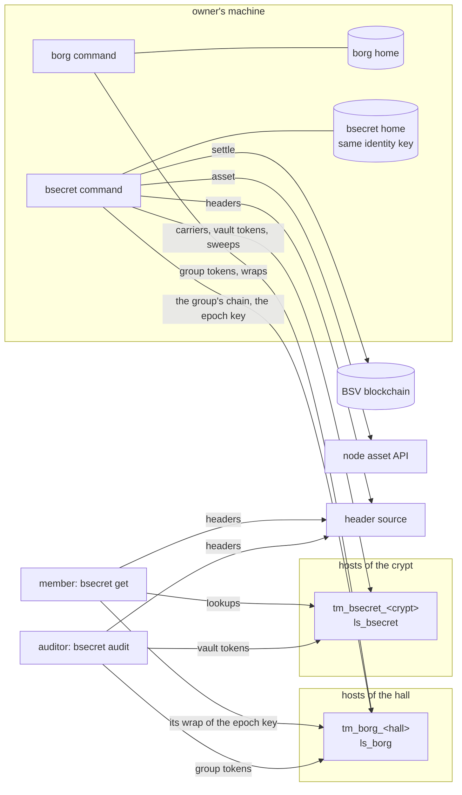

# Architecture

How bsecret's pieces fit, and how it sits on borg. The byte-level contract
is [spec.md](spec.md); what cannot change once published is
[frozen.md](frozen.md).

## The parts

| Part | What it is | Where |
| --- | --- | --- |
| `bsecret` command | the owner's tooling, the member's reader and the auditor's check, one static binary | `cmd/bsecret` |
| bsecret home | one identity's directory: key, coin pool, state. Made around a borg home's identity (`init -borg`) and sharing nothing else with it | `~/.bsecret` |
| borg | the organization, its groups and their epoch keys | [borg](https://github.com/lightwebinc/borg) |
| host module | the topic manager `tm_bsecret_<crypt>` and the lookup service `ls_bsecret`, loaded by a reference overlay host beside borg's module | `host/` (TypeScript), [host.md](host.md) |
| content store | optional: where a ciphertext over the inline bound is kept, a directory or an HTTP base URL | `content` |
| header source, node asset API, settlement leg | as for borg | `header_url`, `asset`, `settle` |
| `devchain` | a local regtest chain for the sandbox and tests; nothing it mines is money | `cmd/devchain` |

## What lives on chain and what lives at the hosts

| Object | Mined? | What it is |
| --- | --- | --- |
| vault token | yes | one per change of a vault: the versions it lists, the epoch it acknowledges, a root over its set |
| chain tree | yes | outputs that begin vaults, 8 a tree |
| secret tree | yes | 1-sat outputs that fund carriers, 32 a tree |
| sweep | yes | spends funding outputs: every honest host stops answering the versions they funded |
| secret carrier | no | one version: its ciphertext (or its hash), the content key wrapped to the owner and under one epoch's key |

A secret's value is sealed under a random content key committed to before
anyone holds it. The key is wrapped twice: once to the owner's own wallet,
once under the key of one epoch of the vault's borg group. A host holds
ciphertext and wraps, never a key.

## The command's layers

| Layer | Package | Role |
| --- | --- | --- |
| records | `internal/secrec` | encode, decode and fold every record; the transition rules every host enforces, including revoke-forces-rotation |
| reader | `internal/vread` | ask hosts the `ls_bsecret` questions and verify every answer against the caller's headers |
| group | `github.com/lightwebinc/borg/reader`, `borgrec` | read the group's chain and open epoch keys from borg's wraps, with borg's own code |
| engine | `internal/engine` | build, persist, settle, wait for and publish vault tokens; carriers; sweeps; `sync`; recovery of interrupted work |
| state | `internal/state` | the home's `state.json`, written atomically, locked one command at a time |
| config | `internal/config` | flags, `BSECRET_*`, the config file, defaults ([configuration.md](configuration.md)) |
| unicast | `internal/unicast` | submit to each host and count the quorum |
| limits | `internal/limits` | every default and cap ([limits.md](limits.md)) |
| shared | `github.com/lightwebinc/bcommon` | funding trees, carriers, PushDrop, the wallet and pool, header clients, node API, publish legs |

## A put, end to end

1. The owner's command takes writer evidence that the vault's and the
   group's latest tokens are unspent (at most `freshness` old).
2. It draws a content key, seals the value, wraps the key to the owner and
   under the current epoch's key (opened from borg's wrap to the
   organization's signer key), and publishes the carrier.
3. It builds the vault's next token listing the version, persists it,
   broadcasts it through `settle`, waits for it to be mined, and publishes
   it after `delay`.

## A revoke, end to end

1. `bsecret rotate -check`: does every secret have a choice?
2. `borg org remove <key> -group G`: borg begins a new epoch whose key the
   removed member never receives.
3. `bsecret rotate`: one token acknowledges the new epoch. From then on
   every host refuses anything on the vault's chain but re-keying or
   retiring what was held under an earlier epoch, until nothing is left.
   The old versions are swept.

Readers report a vault that has not acknowledged as **behind** and its
values as **exposed**; an auditor derives each removal's exposure window
from block headers alone.

## Funding

The owner's bsecret home holds its own coin, separate from the borg home's.
On mainnet and testnet the owner sends a payment from their own wallet to
the fund address `init` prints and imports it with `bsecret fund -txid`.
Fees are 1 sat a byte with a 250-sat floor; a version costs about 900 sat
([limits.md](limits.md)). Members and free audits need no coin. `fund`
without `-txid` mines coinbase (coinbase: only on a regtest chain you run,
for development and tests).

## Trust

| You trust | For | Not for |
| --- | --- | --- |
| the header source | which blocks exist | anything a host says |
| the node (`asset`) | whether a token is still the latest | the content of a record |
| the hosts | availability | integrity or confidentiality: every answer is verified, and hosts hold no key |
| the group's members | keeping what they read | anything after they are removed and the vault re-keys |

A removed member keeps everything it could read. Removal protects what is
written after the vault re-keys.
